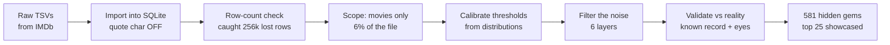

# Hidden Gem Movies — SQL Analysis

A SQL analysis of IMDb's full 12.6-million-title catalog to surface **"hidden
gem" movies**: films audiences love that almost nobody has watched. Built with
SQLite and DB Browser for SQLite. Companion project to
[Steam Hidden Gems](https://github.com/michaelnocito/steam-hidden-gems), which
runs the same hunt for video games.

**Browse the results:** the full ranked list is live (with per-movie voting and
real-time streaming lookups) at
**[michaelnocito.github.io/streaming-hidden-gems-list](https://michaelnocito.github.io/streaming-hidden-gems-list/)**.

## 🎬 The Hidden Gems

Out of **751,802 movies**, only **347,689** have ever been rated by anyone, and
exactly **581** clear every bar of the hidden-gem definition: *rated 8.0 or
higher (the average movie scores 6.13) with 5,000–50,000 votes, a real 60+
minute runtime, and no adult titles.* Enough opinions to trust the score, too
few to be mainstream.

### Top 25 hidden gems

| # | Movie | Year | Genres | Runtime | Rating | Votes |
|--:|---|---|---|---|---|---|
| 1 | Mission C1000 | 2026 | Action | 128 | 9.3 | 5,787 |
| 2 | The Chaos Class | 1975 | Comedy | 85 | 9.1 | 46,425 |
| 3 | Ramayana: The Legend of Prince Rama | 1993 | Action, Adventure, Animation | 135 | 9.1 | 17,832 |
| 4 | Unpaarvayil | 2025 | Thriller | 117 | 9.1 | 5,890 |
| 5 | Attack on Titan: The Last Attack | 2024 | Action, Adventure, Animation | 145 | 9.0 | 32,154 |
| 6 | Mayabazar | 1957 | Comedy, Drama | 192 | 9.0 | 6,984 |
| 7 | Sandesham | 1991 | Comedy, Drama | 138 | 9.0 | 6,476 |
| 8 | David Attenborough: A Life on Our Planet | 2020 | Biography, Documentary | 83 | 8.9 | 36,252 |
| 9 | Tosun Pasha | 1976 | Comedy, History | 90 | 8.9 | 26,506 |
| 10 | O.J.: Made in America | 2016 | Biography, Crime, Documentary | 467 | 8.9 | 23,996 |
| 11 | The Message | 1976 | Biography, Drama, History | 207 | 8.9 | 12,031 |
| 12 | Kireedam | 1989 | Action, Drama | 124 | 8.9 | 9,835 |
| 13 | The Unnamed | 2016 | Drama | 100 | 8.9 | 6,190 |
| 14 | The Devil | 2025 | (not recorded) | 167 | 8.9 | 5,763 |
| 15 | Dominion | 2018 | Documentary | 120 | 8.9 | 5,227 |
| 16 | Mirror Game | 2016 | Crime, Mystery, Thriller | 147 | 8.8 | 31,075 |
| 17 | The Foster Brothers | 1976 | Comedy, History | 80 | 8.8 | 22,633 |
| 18 | The Marathon Family | 1982 | Comedy, Drama | 92 | 8.8 | 18,218 |
| 19 | C/o Kancharapalem | 2018 | Drama | 152 | 8.8 | 10,940 |
| 20 | The Phantom of the Opera at the Royal Albert Hall | 2011 | Drama, Musical, Romance | 137 | 8.8 | 10,881 |
| 21 | Monpura | 2009 | Crime, Drama, Musical | 136 | 8.8 | 9,995 |
| 22 | The Human Condition III: A Soldier's Prayer | 1961 | Drama, History, War | 190 | 8.8 | 8,915 |
| 23 | Natsamrat | 2016 | Drama, Family | 166 | 8.8 | 8,143 |
| 24 | Les Misérables in Concert: The 25th Anniversary | 2010 | Drama, Musical | 178 | 8.8 | 6,830 |
| 25 | Nadodikkattu | 1987 | Comedy | 158 | 8.8 | 6,716 |

**What the list reveals:** the gems skew heavily toward **non-US cinema** —
Turkish comedy classics, Indian cinema across several languages and decades,
Yugoslav and Bangladeshi favorites — plus **documentaries** and filmed stage
productions. These are exactly the movies a US-centric recommendation feed
never surfaces, so "hidden" here largely means *hidden from the
English-speaking mainstream*. See [Scope & Assumptions](#scope--assumptions).

*Rankings are by rating, tie-broken by vote count. Row 14's genres read "(not
recorded)" because the source stores missing values as the literal text `\N` —
shown honestly rather than guessed. Rows 1, 4, and 14 are very new releases
sitting just above the vote floor; early ratings usually settle as votes
accumulate (see [Validation](#validation)).*

---

> ### Why this project is worth a read
> This is a good example of **real-world data and how to troubleshoot it.**
> Nothing about these files behaves like a clean CSV: the import dialog hides
> them by default, a quote-character setting silently ate 256,000 rows, missing
> values are a literal `\N` text that passes numeric tests as 0, and every
> column arrives as TEXT so `'999' > '10000'`. The interesting part isn't the
> final query; it's the process: *counting* before trusting, *catching* a
> truncated import with a row-count check, *calibrating* every threshold from
> the data, and *validating* the output against reality before believing it.
> That loop is most of the actual job of a data analyst, and it's documented
> here step by step.

### The analysis pipeline at a glance



## Data Sources

The two IMDb non-commercial datasets, refreshed daily at
[datasets.imdbws.com](https://datasets.imdbws.com/). Neither full file is
committed (the basics file is 1.1 GB uncompressed); 1,000-row samples in
`data/sample/` show the shape, and the build guide below rebuilds everything
from source.

| Dataset | What it provides | Size |
|---|---|---|
| **title.basics.tsv** | What each title IS: type, name, year, runtime, genres — 12.6M rows | ~1.1 GB |
| **title.ratings.tsv** | How it was RECEIVED: average rating + vote count — 1.7M rows | ~29 MB |

They join on `tconst`, IMDb's title ID — a clean shared key, present in both
files by design.

## Data Quality: Nothing About These Files Is a CSV

Three traps hit before a single analysis query ran, all documented as
first-class content in the query file:

**A quote character silently ate 256,000 rows.** The first import of the 1.1 GB
basics file returned 12,379,576 rows instead of 12,635,420. The import dialog
treated `"` as a quote character; some titles contain one, and the importer
quietly swallowed the rows that followed. These files use no quoting at all, so
the quote character must be set to **none** on import. The row-count sanity
check (Step 1) is what caught it — the data looked fine, browsed fine, and was
missing 2% of its rows.

**IMDb's nulls are fake.** A missing value is the literal two characters `\N`,
not an empty cell. SQLite stores it as text, and `CAST('\N' AS INTEGER)`
silently becomes `0` — so `\N` rows must be excluded explicitly, never trusted
to a numeric test.

**Everything imports as TEXT.** SQLite doesn't know `numVotes` is a number, and
as text `'999'` sorts *after* `'10000'`. Every numeric comparison CASTs first.
Forgetting the CAST doesn't error — it silently returns wrong answers, which is
worse.

**Takeaway:** a table's name, its appearance in a browser, and a successful
import message all prove nothing. Row counts, file sizes, and a known record do.

## Methodology: Filtering Out the Noise

"Hidden gems" only become visible after peeling away several layers of noise,
one filter at a time. Each filter is a deliberate judgment set from the data
(counts and distributions), not a guessed number.

| Layer | Noise | How it's filtered |
|------|-------|-------------------|
| 1 | **Wrong kind** — TV episodes, shorts, video games share the file; movies are ~6% | `titleType = 'movie'` |
| 2 | **No signal** — 54% of movies have zero votes and can't be judged | JOIN to ratings keeps only rated movies |
| 3 | **Small-sample** — a 9.8 from 40 voters isn't better than an 8.5 from 20,000 | Vote floor: `numVotes >= 5000` |
| 4 | **Mainstream** — a beloved blockbuster isn't "hidden" | Vote ceiling: `numVotes <= 50000` |
| 5 | **Missing data** — `\N` runtime means "not recorded," not zero | Excluded explicitly |
| 6 | **Category** — adult titles; sub-60-minute quasi-shorts | `isAdult = '0'`, runtime ≥ 60 |

**The shrink ledger** — every filter's cost, counted before any titles were read:

```
12,635,420  all titles in title_basics
   751,802  titleType = 'movie'
   347,689  ...that anyone has ever rated
    14,295  ...votes in the 5,000-50,000 band
       584  ...rated 8.0 or higher
       581  ...non-adult, real 60+ min runtime   ← FINAL
```

Thresholds were calibrated first: the average rated movie scores **6.13**, so
the 8.0 bar demands a film nearly two points above typical. The vote cutoffs
were counted at 1,000 / 5,000 / 50,000 (48,700 / 18,908 / 4,613 movies) before
choosing the floor and ceiling.

## Scope & Assumptions

Every filter left *out* is also a decision:

- **Whose ratings are these?** IMDb voters skew English-speaking and
  film-enthusiast. A movie can be "hidden" to this audience yet be a household
  name in its home country — which is exactly why the list fills with Turkish,
  Indian, Yugoslav, and Bangladeshi classics. As written, the list answers
  *"hidden to the global IMDb audience."* Stating the audience assumption is
  deliberate: without it the results get quietly misread.
- **Movies only.** TV series spread their ratings across episodes and need a
  different gem definition — a future part, not a footnote.
- **No recency filter.** Brand-new releases can ride devoted early fanbases
  into the list (see Validation). A release-year cutoff is a defensible
  variant, but it would also delete genuinely new gems — documented instead of
  filtered.
- **Snapshot in time.** Ratings drift daily; this analysis is the 2026-07-12
  download.

## Validation

Results were checked five ways before being trusted:

1. **Row-count check** — each table verified against the source file's line
   count. Caught a truncated import (256k missing rows) and, separately, an
   8 KB stub file that should have been 29 MB.
2. **Known-record check** — tt5275892 (*O.J.: Made in America*) verified
   against its public IMDb page: title, year, 8.9 rating, ~24k votes. Its
   467-minute runtime is *real* (a near-8-hour episodic documentary) — a
   reminder that an outlier is not automatically an error.
3. **Monotonicity check** — every stricter filter must return fewer rows.
4. **Count-before-trust** — the shrink ledger above; every count recorded
   before reading any titles. A pre-computed reconciliation (18,908 − 4,613 =
   14,295) even caught a result being mis-read as 14,925 — numbers that must
   agree, checked in advance, catch digit swaps that eyeballs miss.
5. **Reality check** — the final list read with human eyes. Flagged: 2025/2026
   releases near the vote floor (early-vote skew), a visible `\N` in a display
   column, and the judgment call that filmed concerts (*Phantom*, *Les Mis*)
   stay because IMDb types them as movies.

## The Queries Are Written to Teach

The analysis lives in
**[`queries/hidden_gems.sql`](queries/hidden_gems.sql)** — readable right here
on GitHub, or open it in DB Browser and run it step by step. It's deliberately
written as a **learning resource**, not just working code:

- **A `WHY` header on every step** — the reason for the question before the SQL.
- **Line-by-line "read out loud" comments** — each query narrated in plain
  English (`--SELECT (display) a COUNT of every row`, `--WHERE (keep only)
  title type 'movie'`).
- **Each function explained on its first few uses, then phased out.**
- **A glossary block at the top** — every keyword defined in one place.
- **The full reasoning inline** — the import traps, the threshold calibration,
  the shrink ledger, and the validation notes travel with the code.

## 🧠 How to Actually Learn From This

Reading teaches a little. The real method: **rehearse the plain-English
"read out loud" comments until you can say them smoothly out loud.**

**Learning vs. portfolio, first:** this file is commented wall-to-wall on
purpose, as a learning scaffold. That is *not* how you comment professional
work — there, a comment on every obvious line is a red flag. Learn with the
training wheels on; strip to light intent-comments for anything you show an
employer.

**The method:**

1. Take one step at a time.
2. Type and quietly say its read-out-loud comments until you can narrate the
   section **smoothly, with no stumbling**. Stumbling marks the exact gap —
   say it again.
3. Then read and run the SQL. It reads as the answer to a sentence you can
   already say.
4. Level up: hide the SQL and rebuild the query from the comments alone.

**Why this works (real learning science):** self-explanation deepens
understanding; the generation effect — producing beats reading (Slamecka &
Graf 1978, ~*d* = 0.40); and retrieval practice — recalling beats re-reading,
61% vs 40% recall at one week (Roediger & Karpicke 2006), which is why step 4
is the highest-value move. Smooth narration is your live comprehension test.

## How to Build the Database (step by step)

Zero prior setup assumed. The full click-by-click walkthrough — DB Browser
install, the file-picker trap, the Tab separator, the quote-character fix, and
the "three saves" model (Write Changes vs Save Project vs Save SQL) — lives in
**[`docs/DATABASE_SETUP.md`](docs/DATABASE_SETUP.md)**. The short version:

1. Download both `.tsv.gz` files from
   [datasets.imdbws.com](https://datasets.imdbws.com/) and extract into `data/`.
2. DB Browser → **New Database** → `data/imdb.db` (Cancel the table-definition
   dialog).
3. **File → Import → Table from CSV file…** → switch the picker to
   **All files (*)** → import each `.tsv` with **Field separator: Tab** and
   **Quote character: none**. Tables: `title_basics`, `title_ratings`.
4. **Write Changes**, then verify both row counts (Step 1 of the query file):
   expect **12,635,420** and **1,694,281**.

### Troubleshooting

| Symptom | Likely cause | Fix |
|--------|--------------|-----|
| `.tsv` files invisible in the import picker | Picker filters to `*.csv` | Switch the file-type filter to All files (*) |
| Row count comes up ~256k short | Quote character was `"` | Re-import with Quote character set to none |
| Everything lands in one column | Separator left on comma | Set Field separator to Tab |
| Numbers sort wrong ('999' > '10000') | Columns are TEXT | Wrap in `CAST(col AS INTEGER/REAL)` in queries |
| A table's data doesn't match its name | Wrong file picked at import | Verify by columns, not name; `ALTER TABLE x RENAME TO y` |
| Changes disappear after closing | Forgot to save | Click **Write Changes** (data ≠ Save Project) |

## Files

| File | Description |
|------|-------------|
| `queries/hidden_gems.sql` | The full annotated Part 1 analysis (Steps 1–10) |
| `queries/COMMENT_STYLE.md` | The teaching-comment format specification |
| `docs/DATABASE_SETUP.md` | Click-by-click import walkthrough + the three-saves model |
| `data/sample/*.tsv` | 1,000-row samples of both source files |
| `README.md` | This file |

Full data files and `imdb.db` are excluded via `.gitignore` — rebuild locally
using the steps above.

## Roadmap: Visualizing These Findings

This repo is the **methodology home base**. The findings are being rendered in
the tools analysts are actually hired to use:

- [x] **[Browsable list + live voting](https://michaelnocito.github.io/streaming-hidden-gems-list/)** —
  a public front-end for the 581 gems: dense sortable table, column filters
  (decade / runtime / genre / rating / votes), per-movie 💎/😐 voting, and
  real-time streaming availability via IMDb + JustWatch links — live lookups
  instead of a platform dataset that would go stale.
  ([repo](https://github.com/michaelnocito/streaming-hidden-gems-list))
- [ ] **Decade & genre insights (SQL)** — GROUP BY analysis: when were the gems
  made, and which genres over-produce them. *(next)*
- [ ] **Excel dashboard** — the SQL → spreadsheet handoff: gems by decade,
  gems by genre, a rating-vs-votes scatter of the hidden band, and a top-10
  table, charted in the tool analysts touch most.
- [ ] **TV series expansion** — a separate gem definition for episodic ratings.

Each version links back here for the "how it was built" story.

---

## About

Built by **Michael Nocito**, data analyst. This project is part of a broader
set of analyst learning tools and portfolio work:

- 🎮 **[Steam Hidden Gems](https://github.com/michaelnocito/steam-hidden-gems)** —
  the companion analysis that started the hidden-gems series.
- 🧰 **[Analyst Prep Kit](https://michaelnocito.github.io/analyst-prep-kit/)** — hands-on
  Excel, SQL, Python, Power BI, and Tableau practice kits.
- 🌐 **[michaelnocito.github.io](https://michaelnocito.github.io)** — portfolio & more projects.

*Know a hidden gem movie that belongs on this list — or spot one that
shouldn't? Open an issue. Feedback welcome.*
